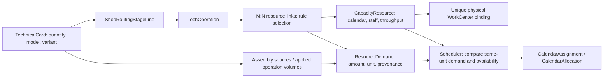

# PC-04.4F — Demand ↔ Capacity Contract Audit

Дата: 2026-10-07. Scope: read-only аудит текущего кода и canonical local PostgreSQL :5432, затем документация. Сначала собрана матрица; runtime/config/frontend не менялись. Восемь существующих ТК прочитаны через тот же read-only service, что GET `/technical-cards/{id}/demand`. Все запросы аудита БД выполнялись с `SET TRANSACTION READ ONLY`. Полный локальный evidence: `logs/pc-04-4f-audit.json`; это generated evidence, не второй источник контракта.

## 1. Executive summary

Архитектурная путаница подтверждена в **настройках ресурсов и границе readiness**, а не в основной формуле количества работы. `base_rate` трудовых explicit_hours ресурсов ошибочно выглядит как норма ТК, но adapter его не использует. Главный blocker ручного раскроя: операция manual-cut связана с manual_cut/explicit_hours/labor_hour; существующий cutters/cutting_methods/item с нормами20/40 не связан с ней и не имеет staff/hours. Поэтому missing_operator_norm ожидаем для текущей конфигурации, а не исправляется увеличением мощности.

Основные численные Demand rules корректны: sewing seconds→labor_hour, full-card quantity→item, verified operation volume→linear_meter. Для печати не настроена машинная связь, print_operator не имеет Demand rule. Для ВТО/дизайна — BUSINESS RULE MISSING. У упаковки Demand ready, но hours_per_day отсутствует: Demand readiness не равна Capacity readiness.

CODE findings: cutting adapter связывает статус Demand с наличием capacity rate; legacy warning-only load-state маркирует часовые числа производственными единицами. Оба изменения требуют отдельного согласованного изменения опубликованного контракта/потребителей; безопасного изолированного runtime patch без этих решений не найдено. Новых P0/потери данных нет; это P2 contract debt и явные config/business blockers, а не основание объявить производственный поток готовым.

## 2. Demand/Capacity matrix

Матрица различает поддерживаемый backend contract и фактическую локальную конфигурацию. Отсутствующая настройка не заменяется нормой/часами из другого поля.

| Operation | Demand source | Demand unit | Capacity source | Capacity unit | Calculation mode | Ready / Gap |
|---|---|---|---|---|---|---|
| Пошив, sewing | Применённые sewing строки ТК + verified AssemblyOperationLine или SalesOrderItemAssemblyOperationSnapshot; секунды×кратность×quantity/3600 | labor_hour | sewers: staff×hours×shifts×efficiency, календарь | labor_hour | sewing_norm | Rule READY; прочитанные ТК blocked из-за нулевых норм/непроверенного источника |
| Ручной раскрой, manual-cut | Сейчас manual_cut не имеет источника hours. Поддерживаемый cutting contract: quantity + однозначный cutting_method | Сейчас labor_hour с amount=null; supported contract item | Сейчас manual_cut:1×8h. Shared cutters должен хранить общий staff/calendar и method productivity | Сейчас labor_hour; supported cutters item | Сейчас explicit_hours; поддержан cutting_methods | CONFIG GAP: linked manual_cut, cutters unlinked/unconfigured |
| Раскрой настилом, opt-cut | Сейчас нет explicit hours. manual_lay уже поддержан как метод manual-cut, но не opt-cut | labor_hour с amount=null; при manual-cut/manual_lay item | opt_cut:1×8h; потенциально тот же фонд раскройщиков — требует подтверждения | labor_hour | explicit_hours | CONFIG + BUSINESS decision: отдельная операция или метод, не объединять автоматически |
| Лазер, laser | quantity всей ТК; volume pieces не используется как split | item | laser: WorkCenter rate100 item/h×hours×shifts×efficiency, count1 | item | rate | Demand rule READY; WorkCenter=null и hours=null — Capacity GAP. Отдельная operator норма не настроена |
| Сублимационная печать, sublimation: machine | Единственная совпадающая routing operation line volume в linear_meters, >0 | linear_meter | Индивидуальный WorkCenter adapter: м/ч×hours×shifts×efficiency | linear_meter | rate | Rule READY; local machine links отсутствуют, generated volume0 не считается нормой |
| Термоперенос, heat_transfer: machine | Отдельная совпадающая operation line volume, не общий объём печатного цеха | linear_meter | Свои допустимые WorkCenters, каждый с собственным adapter/calendar | linear_meter | rate | Rule READY; local machine links отсутствуют |
| Оператор печати / подготовка | Поддерживаемого card/operation estimate или нормы времени нет | labor_hour, amount=null | print_operator:1×10h×shifts×efficiency; shared обеими print operations | labor_hour | explicit_hours | BUSINESS RULE MISSING; base_rate500 не создаёт Demand |
| ВТО, wto | Нет rule секунд/изделие или explicit estimate | labor_hour, amount=null | vto:1×8h×shifts×efficiency | labor_hour | explicit_hours | BUSINESS RULE MISSING; base_rate500 игнорируется этим adapter |
| Упаковка, packaging | quantity ТК, без quantity/rate | item | packing_team:80 item/team-hour×hours×shifts×efficiency, одна бригада | item | team_rate | Demand READY; hours_per_day=null — Capacity GAP |
| Дизайн, design-op | Нет подтверждённой функции из сложности/размеров/деталей и нет estimate input | labor_hour, amount=null | designers:1×10h×shifts×efficiency | labor_hour | explicit_hours | BUSINESS RULE MISSING; размеры/assets сами по себе не время |

Фактические local links: design-op→designers; sublimation и heat_transfer→один print_operator; sewing→sewers; packaging→packing_team; laser→laser; opt-cut→opt_cut; manual-cut→manual_cut; wto→vto. cutters не связан ни с одной операцией. Local sewers.base_rate250, manual_cut200, opt_cut400, print_operator500, vto500 не используются соответствующими sewing_norm/explicit_hours adapters; единицы этих чисел как производственной нормы не подтверждены.

### Adapter inventory

| Dispatch / adapter | Реальный input → output | Source/details | Reasons / ограничения |
|---|---|---|---|
| sewing_norm / sewing_time | Applied sewing identity + verified seconds/multiplicity + quantity → labor_hour | sewing_operation_times; formula_id, norm_table, row ids, seconds_per_item | missing_sewing_norm, sewing_norm_unverified, invalid_quantity; capacity unit mismatch отдельно |
| rate+item / item_throughput | quantity → item | technical_card_quantity; formula_id=technical_card_quantity | invalid_quantity; не читает base_rate/staff/hours |
| rate+linear_meter / linear_meter_throughput | operation/stage match + positive volume → linear_meter | technical_card_linear_meters; operation_line_id, volume, formula_id | missing_linear_meters, ambiguous_operation_volume, route_snapshot_mismatch |
| cutting_methods / cutting | exact code manual-cut + one matching cutting_method + quantity; проверяет method rate → item | technical_card_quantity при ready; cutting_method/rate_key/items_per_person_hour | missing_cutting_mode, missing_cutting_rate, mismatch; readiness coupling с Capacity описан ниже |
| team_rate / team_throughput | quantity → item | technical_card_quantity | Не делит на80 и не умножает на число сотрудников |
| explicit_hours / manual | Реального источника часов нет → amount=null, ожидаемый hourly unit | manual; adapter=manual, expected_unit | labor_hour: missing_operator_norm; machine/team_hour: missing_fixed_norm. Это не реализованная форма ручного ввода |
| milestone / excluded | Не потребляет calendar capacity → not_applicable | milestone либо excluded/resource_excluded | Не доказательство отсутствия технологической работы; не использовать для маскировки missing rule |
| rate+hourly | Сначала candidate quantity/item или volume/meters, затем exact-unit check | candidate_amount/candidate_unit/expected_unit | capacity_unit_mismatch; throughput не превращается в hours через base_rate |

ResourceDemand: amount — decimal string/null; status — ready/missing_input/manual_required/not_applicable; source_type/details — provenance. Отдельного persisted «не подтверждено» статуса нет. Aggregate missing_input имеет приоритет над manual_required. Имена операций обычно не dispatch; единственное явное исключение — cutting adapter с exact code manual-cut. Исторический `estimate_hours` в capacity warning path — отдельный adapter family с иной единицей/inputs, не используется Scheduler.

## 3. Manual cutting

Фактически существуют **две TechOperation**: manual-cut/Ручной раскрой и opt-cut/Раскрой настилом. На первой поддерживается selector manual_single/manual_lay в TechnicalCardOperationLine.cutting_method; volume pieces не служит ручными часами. Сохранённые method и operation/stage identities должны совпасть с route. Selector не действует на laser/opt-cut/sewing/packaging.

В БД: manual_cut и opt_cut — два labor_hour/explicit_hours ресурса с count1/hours8 и base_rate200/400; cutters — отдельный labor/item/cutting_methods ресурс с norm_rates20/40, staff_count=null/hours=null, без operation links. manual_cut не считается одновременно «нормой» и «мощностью» кодом: это Capacity row с отсутствующим Demand adapter input. Смешение возникает в интерпретации настроек, когда base_rate ожидают увидеть нормой ТК. Параллельные ресурсы могут дублировать один фонд работников, но фактический состав команд не доказан — нужны данные владельца, а не автоматическое слияние.

**Минимальный рекомендуемый контракт без новой архитектуры:** если обе операции используют одних раскройщиков, одна manual-cut operation с двумя методами и один shared cutters pool. ТК хранит quantity и cutting_method на applied operation line; 20/40 остаются единственными утверждёнными method productivity values в existing cutters.norm_rates. Общий фонд — staff_count/hours/shifts/efficiency/working_days/exceptions этого единственного пула. Нормы нельзя копировать в manual_cut/opt_cut или ТК.

При текущем **item контракте** Demand=quantity; выбранная ставка влияет на Capacity, не amount. Пример: quantity100, manual_single20, count2,8h → Demand100 item, capacity320 item/day. Для manual_lay40 → тот же Demand100, capacity640. Это математический пример действующего approved rate, не новая норма и не правка БД. Scheduler разрешает только одну method rate на pool/date, не суммирует несопоставимые mixed-method budgets; возможен неиспользованный остаток.

Если владелец выбирает **labor_hour контракт**, technological norm должна иметь отдельный подтверждённый operation/method source; Demand=quantity/rate labor_hour, Capacity=count×hours×shifts×efficiency labor_hour. Сейчас adapter так не работает: cutting_methods+labor_hour даёт capacity_unit_mismatch. Переключать units и создавать norm table/migration в этом аудите нельзя. Нужно определить, является ли ставка технологической нормой или ресурсно-зависимой производительностью. Новый источник не вводится без решения.

CODE-C1: даже при item контракте `_cutting_method` требует положительную rate для ready и передаёт её в details для `_cut_rate`. In-memory probe: при rate20 и40 amount='100'; при отсутствующей rate amount=null/missing_cutting_rate. Quantity не подменяется Capacity, но Demand readiness зависит от настройки мощности. Рекомендуемый будущий seam: вычислять verified quantity/method независимо, затем проверять rate в Capacity readiness. Нужен согласованный cutover PC-04.2F reasons/details и tests; механическая правка нарушила бы текущий published contract.

## 4. Sewing

Норма берётся из **SalesOrderItemAssemblyOperationSnapshot** для SalesOrder-linked ТК; fallback на текущую модель в этом flow запрещён. Standalone ТК использует выбранный AssemblyVariant и его AssemblyOperationLine, только если variant.product_model_id совпадает с card.product_model_id. Applied sewing строки ТК подтверждают scope/identity; duration_seconds/quantity_per_item на этих строках нет. Модель Sew­ingOperation участвует в идентификации и наполнении assembly, но прямой произвольный lookup времени по имени каталога не заменяет selected source.

Formula: `sum(duration_seconds × quantity_per_item) × TK.quantity /3600` labor_hour. Кратность хранится в assembly line или order snapshot, минимум1. Duration — nonnegative integer с default0; отсутствие ввода и сознательно нулевая операция не различаются persisted flag. Любая matched строка duration<=0 блокирует весь sewing step как missing_input/missing_sewing_norm; строка не пропускается, её время не заменяется fallback. Чтобы признать «реально нулевую» работу, нужен явный бизнес-контракт, которого сейчас нет.

missing_sewing_norm: нет применённых строк в scope при проверенном source, либо matched norm duration<=0/invalid multiplicity. sewing_norm_unverified: нет/неверна model/variant связь, нет source rows, applied rows относятся к другому шагу, match неоднозначен/дублирует source. Это reason provenance/identity, не ручной approval status и не автоматическое «нормы не утверждены человеком».

Локальные факты:33 AssemblyOperationLine,14 с duration0. Read-only ТК1/2/3 получают missing_sewing_norm с norm_line_ids25/19/43 **order snapshot**, поэтому исправление только AssemblyVariant не исправит автоматически старый snapshot. ТК25 — standalone variant4, missing_sewing_norm/norm_line_id20. ТК6 — model6 без variant, applied sewing0 → sewing_norm_unverified. ТК26–28 без model/variant → тот же reason. Положительные значения10/15/40/90 у других строк не легализуют нулевые строки. Стоимость/cost/base_rate250 не являются секундной нормой.

ProductModelOperationNorm(norm_qty_per_item, unit) — существующая норма расхода/plan hint, не duration; код использует её для MATERIAL planned_qty. Routing operation rows при apply генерируются volume0, а не verified printing meters. Прямого чтения этой таблицы Demand service не делает. Нельзя считать material hint или shop fact duration_seconds нормой планового времени.

## 5. Printing

Machine Demand: positive TechnicalCardOperationLine.volume с unit linear_meters и совпадающими operation/stage_order/production_stage_id; output linear_meter. По каждому print route step свой объём. Нет конверсии из quantity без operation norm; generated0 остаётся missing input, несколько matching meter rows — ambiguous. Model/material consumption norm не заменяет этот source автоматически.

Machine Capacity: WorkCenter identity/workshop/activity; уникальный adapter хранит rate/calendar один раз. Формула м/ч×hours×shifts×efficiency, count1. TechOperation M:N adapters дают совместимые машины; после PC-04.4D выбирается одна на шаг, labor constraints остаются одновременными. CalendarAllocation.resource_key однозначно разрешается в WorkCenter; API возвращает work_center_id. Перепривязка physical identity с allocations и удаление такой машины защищены. Второго независимого WorkCenter.base_rate нет; norm_rates для legacy scalar rates — derived compatibility mirror, не второй editable machine source.

Фактически обе print операции связаны только с общим print_operator; machine candidate отсутствует. Восемь локальных WorkCenters не равны четырём настроенным плоттерам. Оператор требует real estimate/time norm, которой нет; explicit_hours возвращает amount=null, а ресурсный base_rate500 игнорируется. Работа машины и работа оператора не равны. Нельзя назначить оператору норму150m/15m/h без решения о его занятости/setup/overlap. Operator shared между sublimation/heat_transfer сохраняется, не дублируется.

CODE-C2: legacy `/production-calendar/capacity/load-state` и legacy settings используют `_base_capacity(machine)=productive hours`, а response.unit остаётся linear_meter/item. In-memory probe для15m/h×10h: Scheduler=150 linear_meter, legacy base_capacity=10 machine hours, маркировка linear_meter. Legacy estimate_hours переводит150m в10h; процент без override совпадает, абсолютные единицы нет. Canonical exception30m legacy трактует как30h: процент может стать33.33% вместо500%. Новый `/work-centers/{id}/capacity/load` корректно использует canonical units и persisted allocations. Legacy numbers нельзя читать как Scheduler Demand/Capacity. Исправление старого DTO требует compatibility/consumer contract; в этом audit он не переопределён.

## 6. VTO / Design

**ВТО: BUSINESS RULE MISSING.** Нет утверждённого времени на изделие/модель/операцию или явной оценки на ТК. qty известна, но переход qty→labor_hour не определён. Ресурс vto count1/hours8 определяет доступные8h, а не требуемое время. base_rate500 не используется explicit_hours. ВТО не превращена в milestone.

**Дизайн: BUSINESS RULE MISSING.** Существуют размеры, применённые операции, composition lines, DesignProject/versions/assets и статусы; нет проверенной формулы сложности/числа размеров/деталей→часов и stored explicit estimate, который читает adapter. Наличие этих сущностей не является нормой. Designers count1/hours10 — дневной фонд, не fixed Demand10h. Норму, ручной ввод или статус отсутствия работы должен определить владелец. Дизайн не исключён автоматически.

## 7. Fields classification

| Field | Entity | Meaning | Demand / Capacity / Other |
|---|---|---|---|
| quantity | TechnicalCard | Объём текущей ТК, не group card count | Demand |
| duration_seconds / quantity_per_item | AssemblyOperationLine / SalesOrderItemAssemblyOperationSnapshot | Норма секунд на одно применение и кратность на изделие | Demand norm |
| duration_seconds | TechnicalCardStageResult | Факт исполнения | Other, не Demand norm |
| volume / volume_unit | TechnicalCardOperationLine routing | Applied объём конкретного шага;0 — не verified zero | Demand input |
| cutting_method | TechnicalCardOperationLine | Выбранный manual_single/manual_lay | Routing/config + Demand identity; выбирает Capacity rate |
| norm_qty_per_item / unit | ProductModelOperationNorm | Материальный/operation plan hint | Other norm, не трудочасы автоматически |
| base_rate | CapacityResource | Throughput per productive hour для rate/team_rate | Capacity; при explicit_hours/sewing_norm unused, не Demand estimate |
| norm_rates | CapacityResource | Cutting method productivity / legacy rate mirror | Capacity/business norm config; C1 readiness coupling |
| resource_count (staff_count synonym) | CapacityResource | Headcount для labor;1 team; machine count1 implicit | Capacity |
| hours_per_day | CapacityResource | Productive shift hours до shifts/efficiency, не часы этой ТК | Capacity |
| shifts_per_day / efficiency / working_days | CapacityResource | Доступность ресурса | Capacity |
| capacity / unavailable | ProductionCapacityException | Полный override в canonical unit / недоступность на дату | Capacity |
| capacity_unit | CapacityResource | Каноническая единица бюджета и совместимости demand | Capacity/config, не source amount |
| calculation_mode | CapacityResource | Dispatch recipe demand+capacity, не operation volume | Config; технический seam смешивает responsibilities |
| include_in_calendar_load | CapacityResource | Явное включение ограничения календаря | Config; не подтверждённая нулевая работа |
| production_stage_id / work_center_id | WorkCenter / adapter / routing | Workshop и физическая identity | Other/config |
| planning dates / priority / plan_locked | TechnicalCard | Scheduling eligibility/order/protection | Other, не Demand amount |
| allocated_amount / capacity_unit / resource_key | CalendarAllocation | Сохранённая зарезервированная работа в unit | Plan, не новый Demand/norm |
| amount / unit / status / source_type / details | ResourceDemand DTO | Рассчитанная потребность, её проверенность и provenance | Demand/readiness contract |

Не обнаружено независимых machine rates в двух физических сущностях. Обнаружены избыточные unused base_rate в labor explicit settings и дублирующая историческая hours-estimation ветка, а не две production_scheduler реализации.

## 8. Defects

| ID / category | Finding / severity | Minimal resolution / boundary |
|---|---|---|
| CONFIG-A1 | manual-cut→manual_cut/explicit_hours вместо existing method/pool contract; blockers fail-safe | Подтвердить общий фонд и method model, затем owner config cutover; не менять200/400 и links догадкой |
| CONFIG-A2 | cutters unlinked, staff/hours absent; laser unbound/hours absent; packing hours absent; print machine links absent | Настроить реальные identity/calendar и links; не создавать фиктивные физические машины |
| CONFIG-A3 | Zero sewing norms / missing variant/source; explicit labor base_rate воспринимается нормой | Заполнить реальные нормы в нужном source/snapshot; не auto-fill0 и не читать rate как time |
| CODE-C1, P2 | Demand cutting ready gate читает capacity norm_rates, status зависит от rate при независимом quantity amount | Отдельный согласованный readiness seam, reasons/details compatibility; текущий published PC-04.2F не менять в обход |
| CODE-C2, P2 | Legacy machine load-state hours tagged item/meters; canonical exception units попадают в hourly comparison | План consumer migration на canonical WorkCenter load или явный hour DTO; не менять unit semantics молча |
| BUSINESS-B1 | opt-cut как отдельная операция при already supported manual_lay; общий/раздельный headcount неизвестен | Решение владельца; не объединять и не удалять operations/resources |
| BUSINESS-B2 | Нет norm/estimate для print_operator, ВТО, дизайна | BUSINESS RULE MISSING; отдельные бизнес-решения, zero/milestone не fallback |
| BUSINESS-B3 | Не различаются не введённые и явно нулевые sewing norms; нет estimate/confirmation input | Отдельный schema contract только если реально нужны explicit zero/approval/manual estimates |
| UI-D1 | «По норме времени» для explicit_hours создаёт впечатление доступной нормы; base_rate в hourly resources; generic missing_operator_norm для любых labor rules | Cursor: различить источник Demand, rate и фонд часов; отображать реальные причины. Frontend не изменён |
| UI-D2 | «часы/день» фактически множится на shifts; legacy known_planned_hours с unit item/meters; «Веха» маскирует неготовность | Терминология/DTO отдельно; не объявлять производственное ограничение контрольной точкой |

CONFIG/BUSINESS findings — причины незавершённой readiness текущих данных, не новые P0/P1 persistence defects. Аудит закрывается как карта и решения по границам, но core scenario/module checkbox не закрывается. Переход к mass stress запрещён этой задачей и не выполнялся.

## 9. Changes

Runtime backend, adapters, seed/config data, frontend, schema и migrations **не менялись**. Новые нормы, estimate columns, pools/links, zero fallback и milestone conversion не внедрялись. Реализованные PC-04.2F/4D contracts нельзя переопределить report-only правкой без consumer/business решения. Изменены только этот отчёт, execution note task, canonical checklists/HTML twins и поддержка нового кода в roadmap renderer. Существующий WIP сохранён; commit/push/merge не выполнялись.

## 10. Next actions

1. Владелец подтверждает manual-cut/manual_lay vs opt-cut и общий фонд работников; выбрать existing item contract либо отдельный norm/time contract.
2. Настроить реальные cutting/laser/print/packing links и фонды без подмены отсутствующей Demand нормы; убрать двусмысленную трактовку unused base_rate.
3. Заполнить фактические sewing times и корректные card/model/snapshot связи; отдельно решить необходимость явной нулевой нормы.
4. Утвердить business Demand rules/input для print_operator, ВТО и дизайна; затем отдельные implementation microtasks.
5. Отдельно согласовать C1 readiness separation и C2 legacy DTO/consumer cutover; Cursor уточняет названия после backend contract. Только после readiness — отдельный разрешённый stress slice.

## 11. Checks

Read-only DB audit, восемь Demand reads, in-memory rate/unit probes; existing focused Demand/cutting regressions: **9 passed,1 deselected** (`test_production_demand_pc_04_2b.py`, `test_cutting_method_pc_04_2f.py -k 'not unambiguous_links'`). В focused наборе migration/config-link test исключён намеренно. Mass schedule endpoint, stress validator и seed scripts не запускались на пользовательских данных. Лог: `logs/pc-04-4f-demand-tests.log`. Для проверки документационного renderer после добавления PC-04.4F также выполнен полный repository check; существующие fixture tests не являются новым live stress-run. Его результаты зафиксированы в execution note task. Проверки не создавали allocations/assignments в live VIS-STRESS; результаты предыдущих итераций не выдаются за новые проверки этой задачи.

`git diff --check`, renderer `--check` и MD↔HTML done state sync проверены в конце. Source VIS-STRESS snapshot включает30 ТК, их planning/lock поля, assignments и allocations; before/after равенство проверяется после аудита. Первоначально assignments0/allocations0; пустота не повод создавать новый план. Backend/DB functional readiness не повышена, PC-04.4D и исторический PC-04 остаются открытыми.

VIS-STRESS DATASET UNCHANGED
