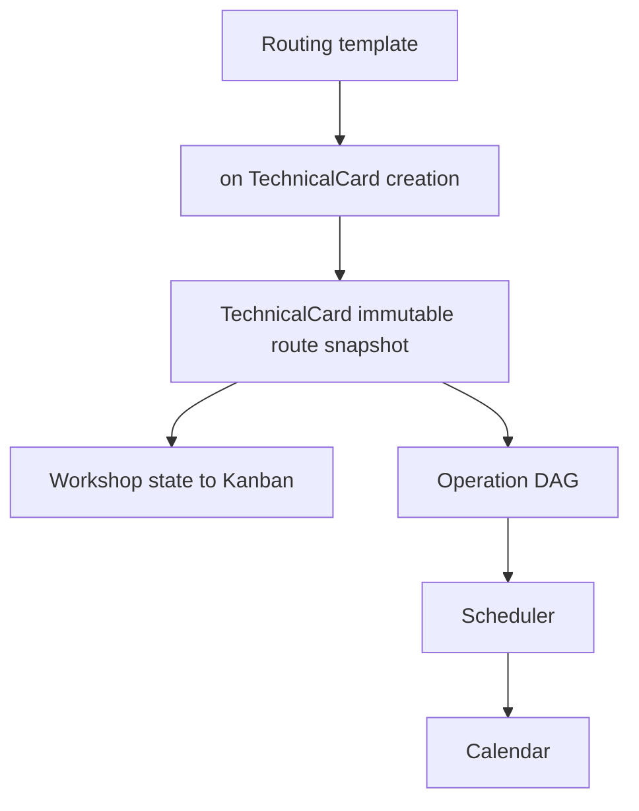

# PC-04.4G — Unified Routing Graph

2026-10-08. PC-04.4G-A, G-B and G-C are implemented. The technical-card route snapshot is the runtime source for Kanban workshop state and for Scheduler/Calendar operation order. The routing template is only the template copied at creation or explicit reapply.

## BEFORE

The repository already had one routing catalog. The defect was that different consumers read different versions of it.

1. `_apply_routing_template` copied workshop and order into `TechnicalCardStageResult`.
2. `load_card_demand_snapshot` then selected the current `ShopRoutingStageLine` rows of `card.routing_template_id`. A later template edit changed the plan of an existing card.
3. The scheduler walked one running earliest pointer. Fact commands required every earlier `stage_order`. Neither read stored edges.
4. `CalendarAssignment.routing_stage_line_id` pointed at the mutable template line with `ON DELETE RESTRICT`.
5. Finished-goods `ready_to_ship` / `shipped` stay lifecycle stages outside the manufacturing DAG. `launch_preparation` stays the calendar entry marker.

Isolated dry-run evidence of the old P1 is `logs/pc-04-4g-snapshot-gap.log`: two copied card nodes, a third live template line, and a scheduler plan of three steps. That read path is removed.

## AFTER

Routing owns the editable structure. The card owns the copied structure.

- Template node: existing `ShopRoutingStageLine`, plus `is_required`. Template `dependency_mode` is `sequential` or `explicit`. Explicit edges live in `shop_routing_node_dependencies`. Composite foreign keys keep both ends on the same template. A self-edge is rejected by the database. A cycle, an unknown node and a cross-template end are rejected before a card snapshot is replaced.
- Card node: existing `TechnicalCardStageResult`. Added `tech_operation_id`, `source_routing_stage_line_id`, `is_required`, `operation_name`, `operation_code`. Card edges live in `technical_card_route_edges`.
- `CalendarAssignment.stage_result_id` is the runtime operation identity, nullable, `ON DELETE SET NULL`, unique per card when set. `routing_stage_line_id` remains provenance and is now also `ON DELETE SET NULL`, so editing or deleting a template line does not block and does not delete the assignment.
- Capacity rates, resource rules and equipment stay on the live `TechOperation` / `CapacityResource` / `WorkCenter`. They are not copied into the graph. The operation code used for demand follows the live operation when that row still exists; which operations exist, and in which order, comes only from the snapshot.

Default template mode writes a sequential chain of operation nodes. Explicit mode copies the stored edges. Finished-goods stages have no tech operation and stay outside the chain. One workshop visit is a consecutive run of the same `production_stage_id`. A repeated visit A → B → A is two visits, not a new shop entity. Cross-workshop parallel execution is not enabled: Kanban still has one current workshop.

## Creation and backfill

`_apply_routing_template` validates an explicit graph before it deletes the previous card rows, then `bind_applied_snapshot` stamps operation identity and edges. Callers:

- standalone card whose nomenclature seeds a model routing, through `apply_routing_template`;
- order card create and cancelled-card revive, through `_apply_routing_snapshot_from_model`;
- a later explicit apply while the card is draft, or in progress with no completed stage.

A standalone card with no model routing has no snapshot until a routing is applied. Copying a card copies the template id and operation volumes, and does not clone stage rows or edges. That copy is not schedulable until a routing is applied. It does not fall back to the live template.

Migration `a7b8c9d0e123` backfills only unambiguous rows. A stage receives a tech operation only when exactly one routing operation line matches the card, stage order and workshop. A source line is stored only when exactly one current template line matches. A card with no stage rows is filled from its current template only when every template line has a workshop and an operation. Sequential edges are inserted only when the card has none. An assignment receives `stage_result_id` only when exactly one snapshot node has that source line. Ambiguous rows stay unmapped. `planning_mode` and `manual_lock` are not rewritten.

Local PostgreSQL `:5432` after upgrade: 35 cards, 30 `VIS-STRESS` with 125 stage rows and 125 operation rows unchanged, 3 assignments still `manual_adjusted` / locked, 0 allocations. Every card has route edges. No self-edges, no cross-card edges, no duplicate source ids, no stage left without an operation. Two assignments mapped to a snapshot node. One assignment stayed unmapped because `routing_stage_line_id` is null. Alembic check reported no further drift. Downgrade was exercised only in a rolled-back schema, not on the dev database.

## Scheduler and Kanban

`load_card_demand_snapshot` reads `TechnicalCardStageResult` rows that have `tech_operation_id`, and predecessors from `TechnicalCardRouteEdge`. If a card has operation nodes and no edges, the loader chains them by `stage_order`. It does not query `ShopRoutingStageLine`.

Placement takes each step's earliest date as the maximum inclusive end of its predecessors, then the existing forward capacity search. Sequential A → B, explicit A → B and A → C, and join B → D with C → D are covered. Mass scheduling keeps each card on its own snapshot while sharing capacity and priority.

Fact status stays `pending` / `in_progress` / `completed` / `skipped`. When edges exist, a step starts only after each predecessor is completed, or skipped when that predecessor is optional. A required skipped predecessor still blocks. The current workshop stays on a visit until every required child of that visit is completed. Optional pending work does not hold the workshop. `ProductionStage.sort_order` is not read as route order.

`read_inputs` still loads the template header and refuses an inactive template (`active_route_required`). That is a readiness gate, not the step list. Cutting-method identity for an existing allocation uses the snapshot node when `stage_result_id` is set. Only an assignment the backfill could not map still reads the live template line, and only to recover the cutting method.

The manual calendar save still checks a live template line when the client sends `routing_stage_line_id`. It does not choose scheduler dependencies.

## Read API

`GET /shop-routings/{id}/graph` remains the template projection. `GET /technical-cards/{id}/route-graph` returns `card_route_snapshot` with `persisted_dependencies` and `scheduler_graph_integrated` when the card has operation nodes and a complete edge set. A card with no edges keeps the G-A legacy projection and does not fall back to the live template. Template and snapshot responses are separate sources.

## Limits

- The template editor at `/settings/catalogs/routings/[id]` writes `dependency_mode` and stage-order edges through the existing template PATCH. `GET /shop-routings/{id}/graph` stays a read-only projection. Saved template edits do not rewrite existing technical-card snapshots.
- No cross-workshop parallel Kanban.
- Copy-card does not clone the snapshot.
- An inactive live template still blocks scheduling.
- Resources and rates are live, by design.

PC-04.4H — Visual Routing Graph Editor
