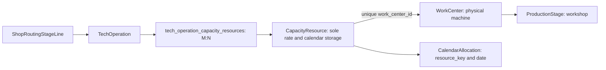

# PC-04.4D — Work Centers as Capacity Source: backend contract

Audit completed before code changes, 2026-10-07. Part A is backend scope; Part B frontend and profile implementation remain separate.

## Audited map

Existing WorkCenter fields: id, unique name/code, nullable production_stage_id, is_active, timestamps. ADR-017 identifies WorkCenter as equipment/place within a workshop; workshop is ProductionStage, not a new Workshop catalog. Existing routing and TechnicalCardStageResult have work_center_id; SewingOperation has a separate compatibility M:N used for sewing norms. That sewing relation is not the TechOperation equipment relation.

CapacityResource already has a unique work_center_id FK, hourly/base rate, canonical unit, hours, shifts, efficiency, working days and dated exceptions. TechOperation already has M:N capacity links. Consequently TechOperation ↔ WorkCenter is already M:N through the uniquely bound adapter; another junction/catalog would duplicate the same relationship. CalendarAllocation.resource_key unambiguously resolves the physical machine through that adapter. No allocation column or migration is required.

Local :5432 audit: eight actual WorkCenters (Epson F9200 and calender in print, six sewing centers), one machine capacity row laser with no physical binding; no four configured plotters. All VIS-STRESS-001…030 present. Tests create four separate plotter records; they are fixture machines, not invented owner inventory. Existing local WorkCenters/owner cards are not edited. Frontend /settings/catalogs/work-centers uses the current catalog identity/department contract; no frontend modifications made here.

## One storage, equipment API

WorkCenter owns one uniquely bound CapacityResource adapter. WorkCenter has no second independent base_rate or calendar fields. Equipment API and existing capacity API edit the same row; legacy keys/links/allocations are preserved. New adapter key is work_center_{id}, with collision rejected. A missing adapter is explicit unconfigured, not default/demo capacity. Machine count is implicit one and never multiplies capacity.

- GET/PUT `/work-centers/{id}/capacity`: canonical detail/settings, including exceptions. PUT excludes independent stage/machine id/count; takes those from the WorkCenter. Rate, unit, hours, shifts, efficiency, working days, include_in_calendar_load and note are editable.
- PUT `/work-centers/{id}/capacity/exceptions/{date}` writes the same canonical dated exception. Existing resource DELETE exception endpoint remains available using the returned resource key.
- GET `/work-centers/{id}/allocations?from=…&to=…`: stored queue within 1..120 dates; physical id, resource key, assignment/card id, day, amount, unit. No manual queue field.
- GET `/work-centers/{id}/capacity/load?date=…`: configured daily canonical-unit capacity, actual stored allocated amount, remaining and utilization_percent. No inferred frontend demand. Inactive/mismatched binding has unknown capacity; incompatible stored allocation unit returns409.

New reads require session; writes require technical_cards.create. WorkCenter PUT validates positive rate for item/linear_meter, no throughput rate for explicit machine_hour, hours×shifts≤24, efficiency0..1 and unique weekdays0..6; unknown fields/count are rejected. Legacy WorkCenter CRUD response remains unchanged. List UI should batch existing capacity/resources once and join by work_center_id, rather than fetch capacity per row. No fat nested exceptions added to list DTO.

Canonical equipment capacity: hourly_rate × hours_per_day (hours per shift) × shifts × efficiency, count=1. Exception unavailable gives0; override replaces the full canonical-unit capacity. machine_hour explicit demand still follows the existing manual/missing policy, without inventing throughput conversions. Date load uses the Scheduler formula, not the historical warning-only load-state hours DTO.

Resource physical identity/type cannot change while CalendarAllocation references it; this protects historical machine resolution. WorkCenter department changes are rejected while bound to a differently staged adapter; deletion with stored allocations returns409. Existing catalog deletion before allocations stays allowed, leaving the adapter explicitly unbound/unconfigured through its existing SET NULL FK. Updates remain possible through the same canonical capacity store. WorkCenter/settings/exception writes share the Scheduler advisory lock; no new locking table.

## Selection

Machine resources linked to one operation are alternative compatible physical machines. Other linked resources remain simultaneous mandatory constraints. Inactive, excluded, unbound or foreign-workshop machines are ignored; if none are viable, capacity_missing/no_compatible_active_machine blocks. This is an equipment pool, not a group of several machines all required for one operation. Separate equipment processes belong to separate route steps.

For each step, trial each eligible machine with the same mandatory demands and a copy of current occupancy. Reuse the existing day-placement algorithm, then choose earliest completion, earliest start and stable resource_key. Only the selected trial consumes capacity. One route assignment stays on one machine across days; no splitting/batch creation. Trials with missing capacity/horizon failure do not consume labor or hide a feasible alternative. Deadlines and queue priority are unchanged.

Protected anchors must reference exactly one eligible machine and current required demands. Older saved plans that reserved all alternative machines simultaneously are not silently reinterpreted: a protected incompatible plan returns conflict. Future AUTO rows rebuild under the new choice rule.

Scheduler allocation JSON adds nullable work_center_id; labor/team allocations have null, machine allocations return the selected physical id. Storage remains the existing resource_key FK. Single-card and mass commands share the new selection. Capacity can be shared by several cards within a date if total amounts fit the machine's daily budget; no sub-day reservation model is claimed.

## Color profiles and operator gap

No existing reusable profile catalog or required-profile field was found. Minimal proposed extension: ColorProfile(id, unique code, name, active), WorkCenter ↔ ColorProfile compatibility M:N, nullable required_color_profile_id on the applied routing TechnicalCardOperationLine. The requirement belongs to the print operation snapshot, not the entire card or free-text machine notes. Null means no explicit profile restriction; an explicit unsupported profile must block. This proposal needs its own approved contract/data migration; no hidden profile filter or placeholder default was implemented.

print_operator remains labor shared across print operations. Missing operator time/norm still returns manual_required; equipment does not replace it. Tests validate both that missing norm blocks and that an existing verified labor-hour demand constrains equipment concurrently. No new print operator norm was introduced.

## Evidence / remaining scope

Tests use four plotters at15/20/10/30 m/h ×10h (150/200/100/300m/day), six cards, one unavailable date, several machines used, individual totals within budget, stable recalc, inactive/foreign/unconfigured candidates, anchors, immutable allocation identity, API/validation, labor and existing mass/concurrency regressions.

`backend/scripts/validate_work_center_stress.py` reads the 30 existing VIS-STRESS identities, quantities, priority, dates, status/lock and creates a print-only clone in a UUID-owned local PostgreSQL schema. It adapts only clone routing/volume and groups for the fixture; omits unrelated shop/operator constraints. It schedules30, uses machines1–4, respects unavailable machine4 on07.10 and per-machine budgets, repeats deterministically, verifies all source card columns unchanged, and removes only its own schema. This is backend stress evidence, not persistent production readiness or frontend visual acceptance.

Part A completion does not close Part B or full PC-04.4D. Remaining: equipment UI fields/load labels, actual owner equipment setup, separate approved color-profile implementation. No production apply, commit/push or user-data deletion.
